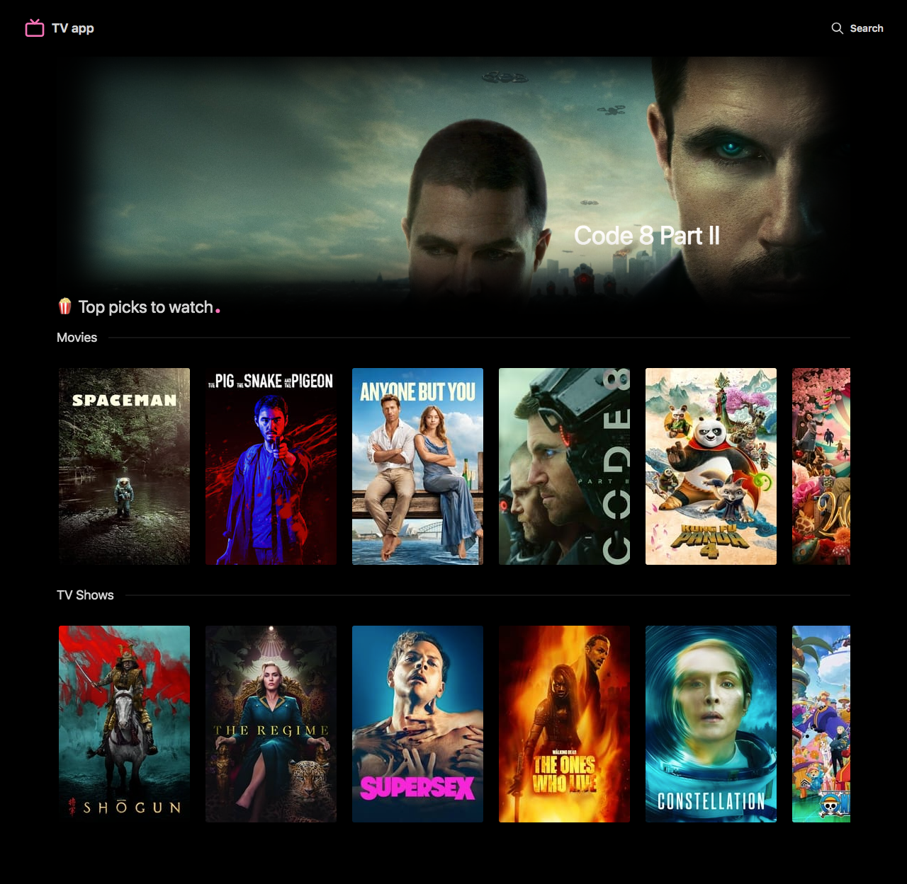
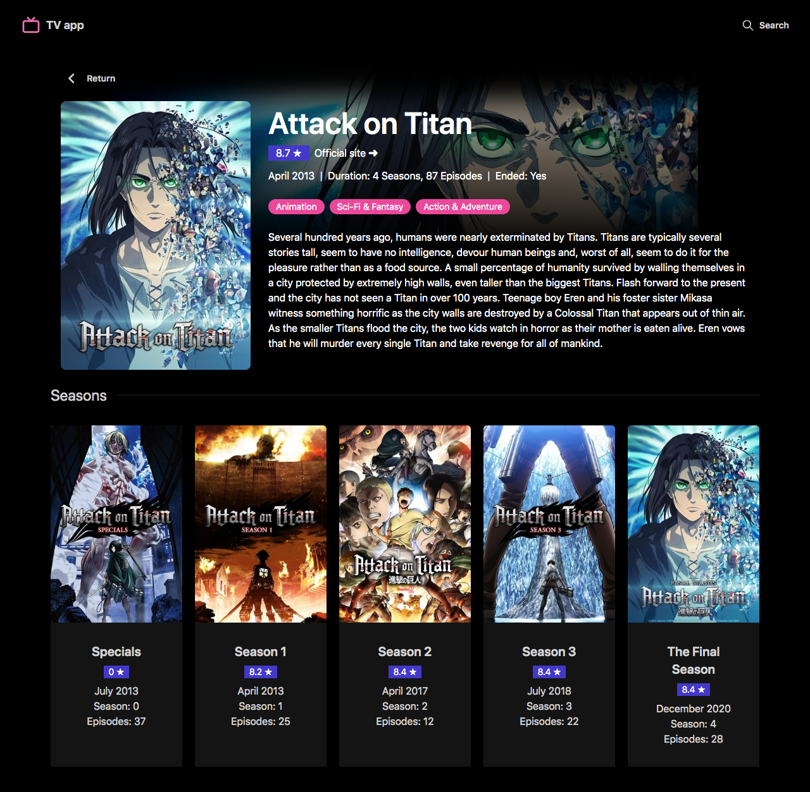
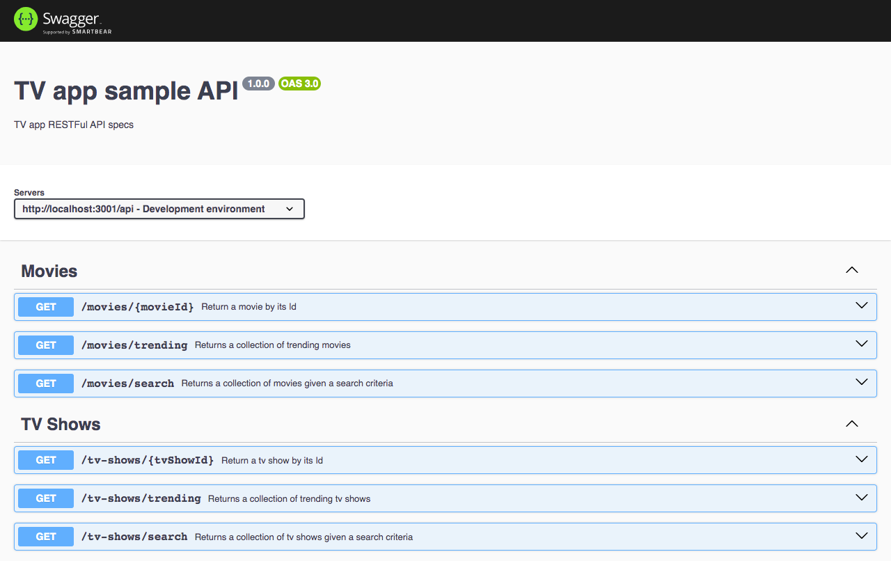
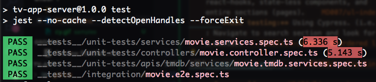
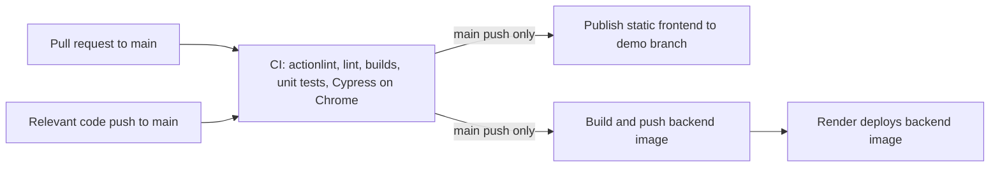
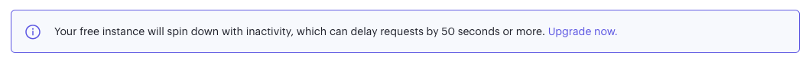
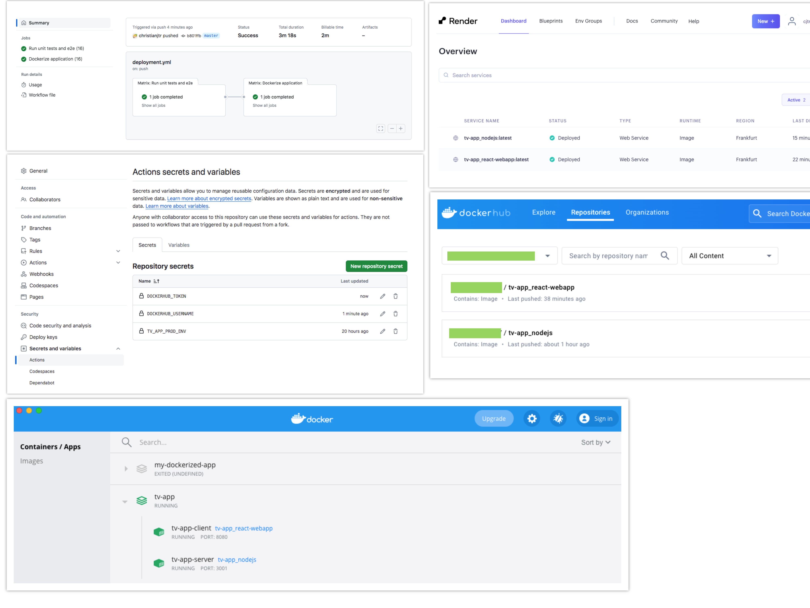

# My TV App application

Proof of concept aimed at putting into practice an e2e development cycle for an application.

> [!NOTE]  
> - :bulb: Monorepo-like project in which services can be deployed and run independently.
> - ❤️ Feel free to add any improvements or suggestions you consider.

1. [Goals](#001)
2. [Considerations](#002)
3. [Tech Stack](#003)
4. [Installation and running the project](#004)
5. [Samples](#005)
6. [Server side](#006)
7. [Tests (unit-tests and e2e)](#007)
8. [CI/CD - Containerization and Deployment](#008)
9. [Next steps](#009)

<a name="001"></a>
### 🎯 Goals

-   Create an application that displays **trending films and TV shows** in two rails.
-   Integrate the **The Movie DB API (TMDB)** to the application.
-   Add the capability of navigating the application using the keyboard (Arrow keys).
-   Implement a CI/CD process using **GitHub Actions, Docker, and a Cloud application hosting service.**

    #### The movie DB API:

    To implement the solution, we are required to sign up [themoviedb.org](https://www.themoviedb.org/), and also **integrate it to our back-end** then, we will be able to use their API services. For further details, check the specs here [TMDB API specs](https://developer.themoviedb.org/reference/intro/getting-started).

<a name="002"></a>
### Considerations

Please, check this consideration out.

> [!IMPORTANT]
>
> -   The architecture is a **mono repo-like project** that uses **workspaces to share type definitions among the app's tiers**.
> -   The application can be either **started locally or containerized**.
> -   Each app tier, within the project, can be started for development **independently from the others**.

<a name="003"></a>
### Tech Stack

This conceptual test has been developed using the following technologies:

-   **Front-end**
    -   [React](https://react.dev/)
    -   [TypeScript](https://www.typescriptlang.org/)
    -   [Vite](https://vitejs.dev/)
    -   [Tailwind CSS](https://tailwindcss.com/)
    -   [DaisyUI](https://daisyui.com/)
-   **Back-end**
    -   [Express](https://expressjs.com/)
    -   [Node Cache](https://www.npmjs.com/package/node-cache)
    -   [Joi](https://github.com/hapijs/joi#readme)
    -   [Swagger](https://swagger.io/)
-   **Tests (Unit test and E2E)**
    -   [Jest](https://jestjs.io/)
    -   [React Testing Tools](https://testing-library.com/)
    -   [Cypress](https://www.cypress.io/)
    -   [SuperTest](https://www.npmjs.com/package/supertest)
-   **Containerization and Deployment**
    -   [Github Actions](https://docs.github.com/en/actions)
    -   [Docker](https://www.docker.com/)
    -   [Render](https://render.com/)
-   **Architecture**
    -   [NPM workspaces](https://docs.npmjs.com/cli/v10/using-npm/workspaces)

<a name="004"></a>
### Installation and running the project

The project requires:

-   [Node.js 26.13.1](https://nodejs.org/) and npm 11.20.0
-   [Docker](https://www.docker.com/)

**Clone the repository:**

```shell
git clone https://github.com/christianjtr/tv-app.git
```

**Scripts:**

From the repository root, run **npm ci** once, then build the shared types before using the scripts:

```shell
npm ci
npm run build:shared-types

# Run the entire development environment for both client and server tiers
> npm run dev:app

# Run dev environment for the client-side
> npm run dev:client

# Run development environment for the server-side
> npm run dev:server

# Run unit tests for the client-side tier
> npm run test:client

# Run e2e tests for the client-side tier
> npm run test:client:cy

# Run unit tests for the server-side tier
> npm run test:server

# Build shared types across the application
> npm run build:shared-types

# Perform docker-compose to containerize and run the application
> npm run dev:docker:build-up
```

The Cypress E2E script starts the client and Express API with a local fixture-backed TMDB stub; it does not require TMDB credentials.

**Environment variables:**

Each app's tier within the project has its own environment variables file, you **should create a .env file following the templates provided** in the corresponding directory.

| Tier   | template     | directory | environment file to create |
| ------ | ------------ | --------- | -------------------------- |
| client | .env.local   | /app      | .env                       |
| server | .env.example | /server   | .env                       |

The production client is a static build, so `VITE_API_BASE_URL` and `VITE_APP_BASE_PATH` are build-time settings. `VITE_API_BASE_URL` is required and must include the backend `/api` prefix; the base path defaults to `/`. The GitHub Pages demo uses `VITE_API_BASE_URL=https://tv-app-nodejs-latest.onrender.com/api`, `VITE_APP_BASE_PATH=/tv-app`, and `VITE_ENABLE_API_MOCK=false`.

<a name="005"></a>
### Samples

##### Live demo

Click on the following link [GitHub page project](https://christianjtr.github.io/tv-app). 

**Note:** The demo frontend fetches live data from the Render-hosted backend.

##### Preview

<p align="center">
    
</p>

##### Home page preview



##### Detail page preview



<a name="006"></a>
### Server side

##### API specs

The server-side API follows the [OpenAPI Specification - Version 3](https://swagger.io/specification/)

```shell
# Enter the API's specs documentation by browsing to this URL.

<YOUR HOST>/api/docs
```



<a name="007"></a>
### Tests (unit-tests and e2e)

Both services have some examples of how to develop unit tests and e2e tests (including some mocking strategies).

-   **Client-side:**

    -   Unit testing for services, react-hooks, state-less components, and the entire sections (pages).
    -   **E2E testing:** Using Cypress. (i.e.: Navigate to the search section and look for a movie).


<p align="center">
    
</p>

-   **Server-side:**
    -   Unit testing for services, controllers, etc.
    -   **E2E testing:** Using SuperTest. (i.e.: Simulate a running back-end to perform requests).



<a name="008"></a>
### CI/CD - **Containerization and Deployment**



The production frontend is a static Vite build published to the `demo` branch for GitHub Pages. The Express API is bundled with esbuild, built into a Docker image, and deployed through Render.

##### Production containers

- Production Dockerfiles account for npm workspaces and shared types.
- The frontend production image serves the static Vite build from Nginx.
- The server production image runs the esbuild bundle on Node.js.
- Docker Compose files support local development and production builds.
    - Use the tier-specific env files described above.

##### GitHub Actions

- Pull requests to `main` run actionlint, client/server lint and builds, unit tests, and Cypress in Chrome.
- Relevant code pushes to `main` publish the frontend to `demo` and push the backend image to Docker Hub.
- Docker Hub credentials are provided through repository secrets.

##### Render

Render hosts the production API from the backend image published by GitHub Actions. The frontend demo is a static GitHub Pages site.



Look at this [article on how to deploy pre-built docker images](https://docs.render.com/deploy-an-image) on their side.

-   [TV application](https://tv-app-react-webapp-latest.onrender.com/)
-   [API service docs](https://tv-app-nodejs-latest.onrender.com/api/docs)

    **Note:** The frontend uses the Render API, which proxies TMDB catalog requests.



<a name="009"></a>
### Next steps

-   Decide the dependency-update and action-pinning policy before adding an update bot.
-   Improve spatial D-pad navigation and accessibility.
-   Refine hero imagery and review the carousel library.
